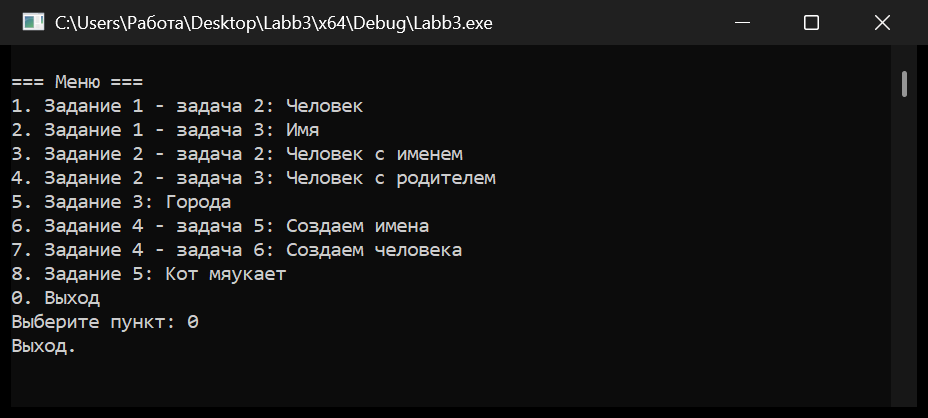
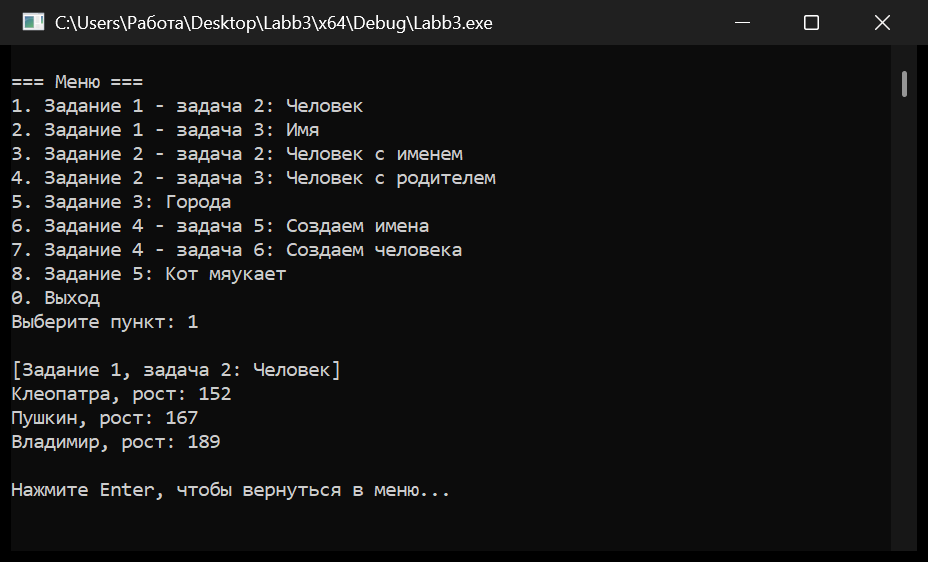
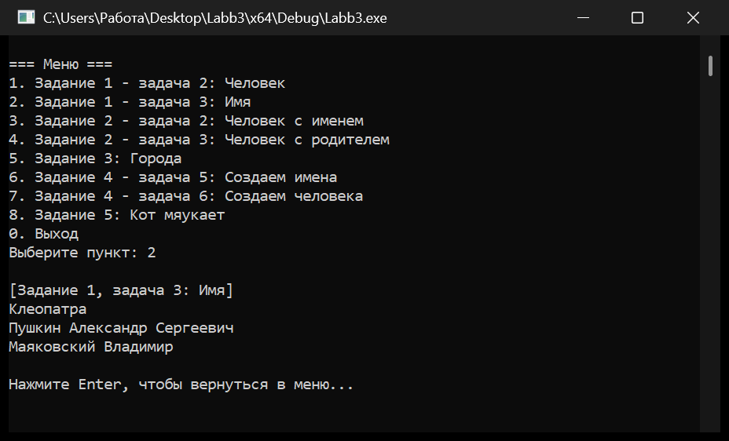
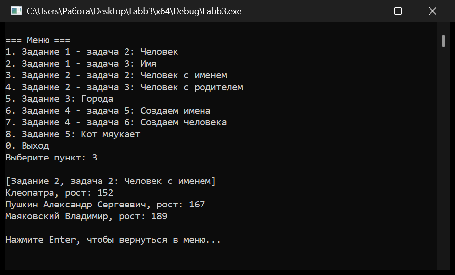
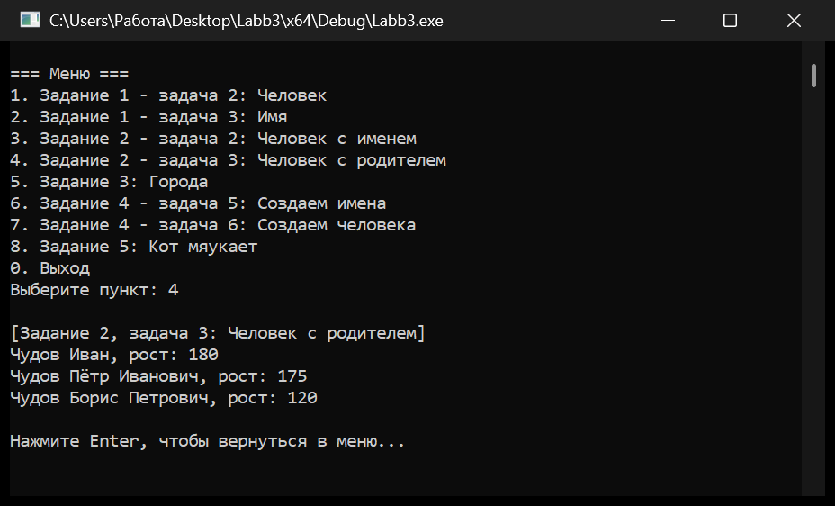
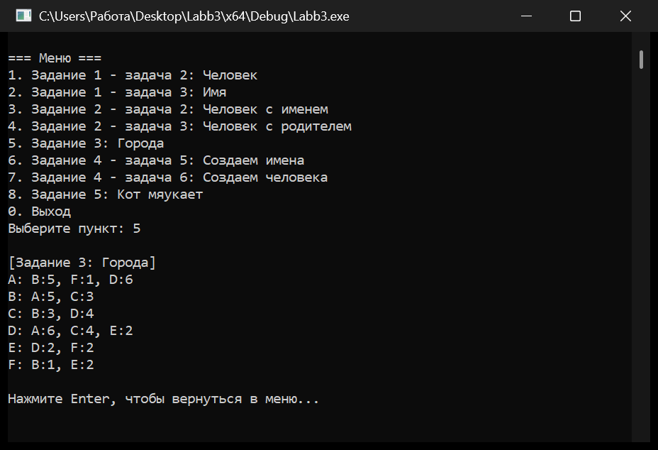
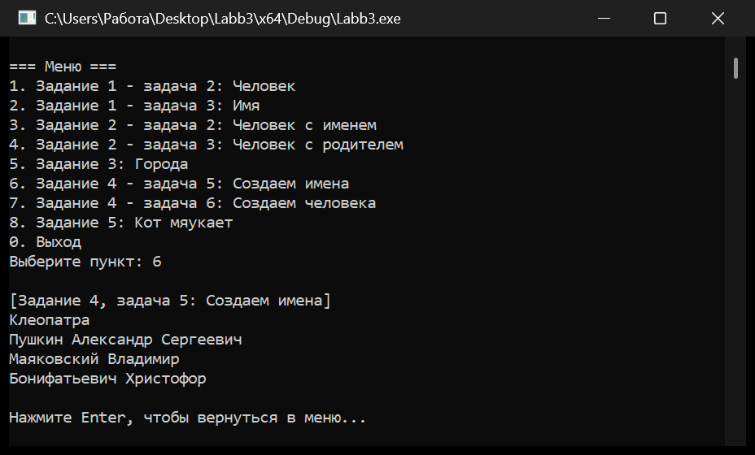
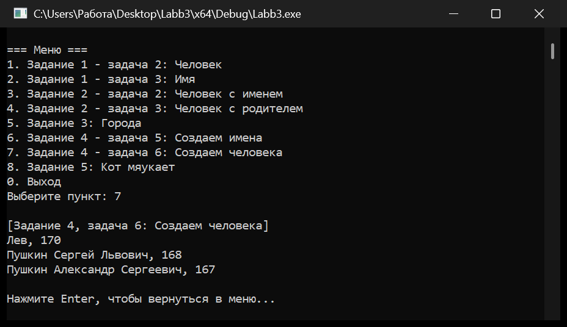
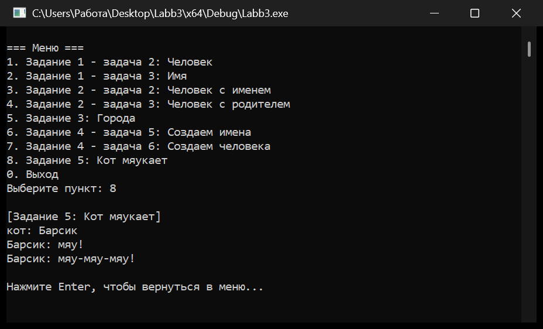

# Сальников Михаил Группа ЛА-2 Лабораторная №3

## О программе

Программа на C++20 (Visual Studio, платформа x64) демонстрирует работу с классами:
инкапсуляцию, перегрузку конструкторов, делегирующие конструкторы, композицию
объектов и ссылки между объектами. Все задания лабораторной собраны в один
исполняемый файл с текстовым меню: каждый пункт меню — отдельная задача.

Состав проекта:

| Файл | Содержимое |
|------|------------|
| `Labb3.h` | объявления классов `Name`, `Person`, `City`, `Cat` и вспомогательного пространства имён `console` |
| `Labb3.cpp` | реализация классов и вывод строк в консоль |
| `main.cpp` | меню и демонстрационные сценарии для каждого задания |

Общая структура классов:

| Класс | Назначение | Основные члены |
|-------|------------|----------------|
| `Name` | полное имя человека | `surname_`, `given_name_`, `patronymic_` (любая часть может отсутствовать) |
| `Person` | человек с именем, ростом и необязательным отцом | `name_`, `height_`, `father_` |
| `City` | город и исходящие из него пути | `name_`, `paths_` (`std::vector<Path>`) |
| `Cat` | кот, который умеет мяукать | `name_` |

Меню программы:



# Задание 1

## Задача 2

### Текст задачи

Создать класс `Person` (человек), хранящий имя и рост. Создать трёх человек —
Клеопатру (рост 152), Пушкина (167) и Владимира (189) — и вывести каждого
в формате «Имя, рост: N».

### Алгоритм решения

Класс `Person` хранит объект имени `Name name_`, рост `int height_` и указатель
на отца `const Person* father_` (в этой задаче он равен `nullptr`). Конструкторы
принимают строку с именем и рост, из строки создаётся объект `Name`, после чего
все конструкторы делегируют в один «главный» конструктор с тремя параметрами:

```cpp
Person::Person(Name name, int height, const Person* father)
    : name_(std::move(name)), height_(height), father_(father) { ... }
```

Метод `ToString()` склеивает полное имя и рост:

```cpp
return name_.ToString() + ", " + std::to_string(height_);
```

Демонстрационный сценарий создаёт три константных объекта и выводит их через
`PrintPersonLegacy()`, который печатает строку в формате задания:
`имя, рост: N`.

### Тестирование



## Задача 3

### Текст задачи

Создать класс `Name` (имя), состоящий из фамилии, личного имени и отчества.
Любая из частей может отсутствовать. Создать имена: «Клеопатра» (только личное
имя), «Александр Пушкин Сергеевич» и «Владимир Маяковский» (без отчества)
и вывести их, пропуская отсутствующие части.

### Алгоритм решения

Класс хранит три строки и предоставляет три конструктора: только личное имя;
личное имя и фамилия; личное имя, фамилия и отчество. Порядок параметров —
«имя, фамилия, отчество», поэтому `Name("Александр", "Пушкин", "Сергеевич")`
даёт «Пушкин Александр Сергеевич».

Метод `ToString()` добавляет части по очереди, пропуская пустые строки
и разделяя непустые пробелом, поэтому отсутствующее отчество не оставляет
двойного пробела:

```cpp
append_part(surname_);
append_part(given_name_);
append_part(patronymic_);
```

Для проверки наличия частей есть методы `has_surname()`, `has_given_name()`,
`has_patronymic()`.

### Тестирование



# Задание 2

## Задача 2

### Текст задачи

Изменить класс `Person` так, чтобы он хранил не строку, а объект класса `Name`.
Создать людей с полными именами (Клеопатра, Александр Пушкин Сергеевич,
Владимир Маяковский) и вывести их вместе с ростом.

### Алгоритм решения

Поле имени имеет тип `Name`, поэтому в конструктор можно передать как готовый
объект `Name`, так и строку — строка автоматически оборачивается в `Name`:

```cpp
Person::Person(std::string name, int height)
    : Person(Name(std::move(name)), height) {}
```

Вывод выполняется методом `Person::ToString()`, который вызывает
`Name::ToString()` и добавляет рост. В результате для человека с полным именем
печатается «Пушкин Александр Сергеевич, рост: 167».

### Тестирование



## Задача 3

### Текст задачи

Добавить в класс `Person` информацию об отце. Если при создании человека
не указаны фамилия и отчество, они должны наследоваться от отца: фамилия
копируется, а отчество образуется из личного имени отца. Создать Ивана Чудова
(рост 180), его сына Петра (175) и внука Бориса (120).

### Алгоритм решения

Отец хранится указателем `const Person* father_`, потому что `Person` не владеет
отцом и не должен его копировать. Наследование выполняется в главном
конструкторе, куда делегируют остальные:

```cpp
if (!name_.has_surname() && father_->name().has_surname()) {
    name_.set_surname(father_->name().surname());
}
if (!name_.has_patronymic() && father_->name().has_given_name()) {
    name_.set_patronymic(MakePatronymic(father_->name().given_name()));
}
```

Таким образом, уже указанные вручную фамилия и отчество никогда не
перезаписываются. Для Петра фамилия «Чудов» наследуется от Ивана, а отчество
«Иванович» образуется из имени отца; для Бориса — фамилия «Чудов» и отчество
«Петрович» от Петра.

Функция `MakePatronymic()` образует мужское отчество по правилам русского языка:

* отдельные исключения для имён «Пётр», «Павел», «Лев», «Яков», «Михаил»,
  «Дмитрий», «Данила», «Гаврила»;
* окончание «-ий» заменяется на «-ьевич» (Дмитрий → Дмитриевич);
* окончания «-й» и «-ь» заменяются на «-евич» (Андрей → Андреевич);
* окончания «-а» и «-я» заменяются на «-ич» (Никита → Никитич);
* во всех остальных случаях добавляется «-ович» (Иван → Иванович).

### Тестирование



# Задание 3

### Текст задачи

Создать класс `City` (город), хранящий название и список путей в другие города
с указанием стоимости проезда. Построить граф из шести городов A–F и вывести
для каждого города все исходящие пути в формате «A: B:5, F:1».

### Алгоритм решения

Внутри класса объявлена вложенная структура `Path` с указателем на город
назначения и стоимостью:

```cpp
struct Path {
    const City* destination;
    int cost;
};
```

Города связаны указателями, а не значениями: `City` не владеет городом
назначения, поэтому копирование объектов не приводит к дублированию графа.
Метод `AddPath()` добавляет путь в вектор `paths_`.

Метод `ToString()` печатает название города, двоеточие и список путей; первый
путь отделяется пробелом, остальные — запятой с пробелом:

```cpp
result += first ? " " : ", ";
result += path.destination->name();
result += ":"; result += std::to_string(path.cost);
```

В демонстрационном сценарии создаются города A–F и связи между ними:
A–B (5), A–F (1), A–D (6), B–C (3), C–D (4), D–E (2), E–F (2), F–B (1)
и обратные к ним. Каждый город выводится отдельной строкой.

### Тестирование



# Задание 4

## Задача 5

### Текст задачи

Создать четыре имени — «Клеопатра», «Александр Пушкин Сергеевич»,
«Владимир Маяковский» и «Христофор Бонифатьевич» — и вывести их полные записи.

### Алгоритм решения

Используются все три конструктора класса `Name`: с одним аргументом (только
личное имя), с двумя (личное имя и фамилия) и с тремя (личное имя, фамилия,
отчество). Вывод выполняется методом `Name::ToString()`, который пропускает
отсутствующие части, поэтому для Клеопатры печатается только имя, для
Маяковского — фамилия и имя, для Пушкина — фамилия, имя и отчество.

### Тестирование



## Задача 6

### Текст задачи

Создать человека по имени Лев (рост 170), его сына Сергея Пушкина (168)
и внука Александра (167), используя наследование фамилии и отчества от отца.

### Алгоритм решения

Сценарий повторяет логику задачи 2.3, но с другой цепочкой родства:
Лев → Сергей → Александр. Для Сергея фамилия «Пушкин» указана явно, а отчество
«Львович» образуется из имени отца; для Александра наследуются и фамилия
«Пушкин», и отчество «Сергеевич». Вывод выполняется методом
`Person::ToString()` в формате «Имя Фамилия Отчество, рост».

### Тестирование



# Задание 5

### Текст задачи

Создать класс `Cat` (кот) с именем. Метод `Meow()` должен выводить «Имя: мяу!»,
а метод `Meow(count)` — «Имя: мяу-мяу-…-мяу!» с указанным числом повторов.
Проверить работу на коте Барсике.

### Алгоритм решения

Класс хранит имя и предоставляет два метода мяуканья. `Meow()` без параметров
делегирует в `Meow(1)`, а `Meow(count)` собирает строку в цикле, разделяя
повторы дефисом и добавляя восклицательный знак:

```cpp
std::string result = name_ + ": ";
for (int i = 0; i < count; ++i) {
    if (i > 0) { result += '-'; }
    result += "мяу";
}
result += '!';
```

При `count <= 0` метод ничего не выводит. Метод `ToString()` возвращает строку
«кот: Барсик».

### Тестирование



# Особенности реализации

* **Меню.** В `main.cpp` пункты меню описаны массивом структур
  `MenuItem { int id; const char* title; void (*run)(); }`. Обработчик пункта —
  указатель на функцию, поэтому добавление новой задачи сводится к одной строке
  в таблице. Ввод числа проверяется: при ошибке выводится сообщение,
  поток очищается, и меню повторяется; при `Ctrl+Z`/конце файла программа
  корректно завершается.
* **Вывод русского текста.** Исходные файлы сохранены в UTF-8, проект собран
  с ключом `/utf-8`. Функция `console::Print()` переводит строку в Unicode
  (`MultiByteToWideChar`) и выводит её через `WriteConsoleW`, поэтому русский
  текст одинаково правильно отображается в консоли Visual Studio и в окне
  `cmd`; при перенаправлении вывода в файл строка перекодируется в CP1251.
* **Управление памятью.** Объекты создаются на стеке, связи между ними
  организованы указателями (`const Person*`, `const City*`), поэтому
  динамического выделения памяти и утечек нет.
